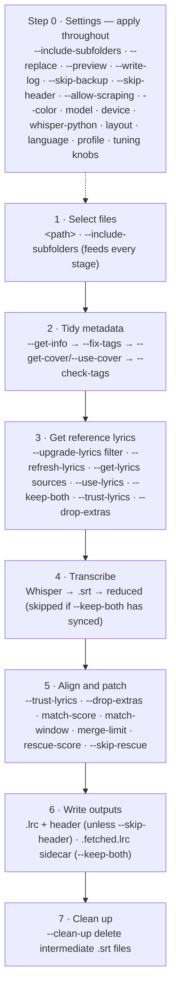

# PyLy 2 — Lyrics for your music, the offline way

PyLy listens to your music and writes synced lyrics files for it — no account needed, no internet required by default.

It runs your audio through [Whisper](https://github.com/openai/whisper) (an offline speech-to-text model), cleans up the result, and saves a `.lrc` file next to your audio. Plex picks that file up automatically and shows lyrics in sync as the song plays.

> **Your audio files are never touched.** PyLy only ever reads them — with two opt-in exceptions: `--fix-tags` (`-f`) deliberately rewrites tags to fix them, and `--use-cover` (`-s`) or `--get-cover` (`-v`) embeds cover art. Both make a backup first by default. See [Checking and fixing tags](#checking-and-fixing-tags) and [Cover art](#cover-art).

---

## Table of Contents

* [Before you start](#before-you-start)
* [Install](#install)
* [Quick start](#quick-start)
* [What PyLy creates](#what-pyly-creates)
* [Getting lyrics](#getting-lyrics)
* [Your own lyrics file](#your-own-lyrics-file)
* [Checking and fixing tags](#checking-and-fixing-tags)
* [Filling in album.nfo](#filling-in-album-nfo)
* [Cover art](#cover-art)
* [Refreshing and upgrading lyrics](#refreshing-and-upgrading-lyrics)
* [Settings file and profiles](#settings-file-and-profiles)
* [How a run is ordered](#how-a-run-is-ordered)
* [All flags](#all-flags)
* [Moving from PyLy 1](#moving-from-pyly-1)
* [ffmpeg](#ffmpeg)

---

## Before you start

You'll need a few things installed:

- **Python 3.10 or newer** — [python.org](https://www.python.org/downloads/)
- **Whisper** — the speech-to-text model that does the heavy lifting
  ```
  pip install openai-whisper torch
  ```
- **ffmpeg** — used internally to read audio. If you don't have it, see [ffmpeg](#ffmpeg) below.

**Optional but recommended:**

- **A CUDA-capable GPU** — Whisper is noticeably faster on a GPU. If you have an Nvidia card:
  ```
  pip install --upgrade torch torchvision torchaudio --index-url https://download.pytorch.org/whl/cu121
  ```
  Then pass `--device cuda` when running PyLy.

- **ffprobe** — part of the ffmpeg package on most systems. Used to read track metadata (artist, album, etc.) and measure the length of your audio. Not required, but things work better with it.

---

## Install

From the project folder:

```
pip install -e .
```

Or on Windows, just use `pyly.bat` — it will install PyLy automatically the first time and run your command:

```
pyly.bat "R:\Local\Queen\A Night at the Opera\11 Bohemian Rhapsody.mp3"
```

Or on Linux systems, just use `pyly.sh` — it will install PyLy automatically the first time and run your command:

```
# Make the file executable (once)
sudo chmod +x pyly.sh
# Run the program as intended
pyly.sh "R:\Local\Queen\A Night at the Opera\11 Bohemian Rhapsody.mp3"
```

---

## Quick start

**One song:**

```
pyly "R:\Local\Queen\A Night at the Opera\11 Bohemian Rhapsody.mp3"
```

PyLy will listen to the file, figure out the words, and save `11 Bohemian Rhapsody.lrc` in the same folder. That's it.

**A whole album:**

```
pyly "R:\Local\Queen\A Night at the Opera"
```

**Your entire music library:**

```
pyly "R:\Local" --include-subfolders
```

**Already have `.lrc` files and want to regenerate them?**

By default PyLy won't touch existing files. Add `--replace` to replace them:

```
pyly "R:\Local" --include-subfolders --replace
```

**Want to keep things tidy?** Add `--clean-up` to delete the temporary files PyLy creates along the way (they're only useful for debugging):

```
pyly "R:\Local\Queen\A Night at the Opera\11 Bohemian Rhapsody.mp3" --clean-up
```

---

## What PyLy creates

When you run PyLy on `11 Bohemian Rhapsody.mp3`, you'll find these new files in the same folder:

| File | What it is |
|---|---|
| `11 Bohemian Rhapsody.srt` | Raw transcript from Whisper |
| `11 Bohemian Rhapsody.red.srt` | Same transcript, with noise and junk lines removed |
| `11 Bohemian Rhapsody.lrc` | The final lyrics file — this is what Plex reads |
| `11 Bohemian Rhapsody.pyly.log` | A log of what happened, only created if you pass `--write-log` |

The `.srt` files are just intermediate steps. The only file you actually need is the `.lrc`. You can delete the others, or have PyLy do it for you with `--clean-up`.

**Supported audio formats:** `.mp3` `.flac` `.wav` `.m4a` `.aac` `.ogg` `.opus` `.alac` `.wma` `.aiff`

---

## Getting lyrics

PyLy can get lyrics in two main ways: downloading from online sources or using Whisper to transcribe the audio. By default, PyLy tries to download synced lyrics first and only uses Whisper for tracks without online matches.

### Action flags for lyrics

- `--make-lyrics` (`-m`): **Default action**. Download synced lyrics first; run Whisper only for tracks still without them. Plain lyrics found online, or from `--use-lyrics`, become the reference Whisper is matched against.
- `--get-lyrics` (`-g`): Download lyrics only, never run Whisper. Tracks with no synced lyrics are skipped. Use `--make-lyrics` alongside to pick which sources are searched.
- `--refresh-lyrics` (`-y`): Download again from the address saved in each `.lrc` (`[PyLy:<url>]` header line) and save. Use `--preview` to only report what would change.
- `--upgrade-lyrics`: Only tracks whose `.lrc` was made by Whisper (no `[PyLy:<url>]` line); replace it when a source has synced lyrics; never run Whisper.

### Sources and how to choose them

Online sources are tried in order until one finds lyrics. The default source is `musicbrainz`.

- `lrclib`: A free, open database of synced lyrics. Fast and simple.
- `musicbrainz`: Uses MusicBrainz to look up the canonical recording first, then fetches from lrclib using that cleaner metadata. Slower (about 2–3 seconds per track on the first pass), but more accurate for messy or unusual filenames.
- `lyricradar`: Aggregates several sources and returns synced (timestamped) lyrics as well as plain text. Requires `--allow-scraping`.
- `genius`: Genius.com, scraped from the song page. Plain (un-synced) lyrics, usually complete and uncensored. Requires `--allow-scraping`.
- `musixmatch`: Musixmatch, via the backend its own apps use. Large catalog of synced lyrics; falls back to plain text when a song has none. Requires `--allow-scraping` **and** a Musixmatch login key (see [Musixmatch key](#musixmatch-key)).

**Custom search templates:** Add `:query` after the sources to set a custom search (e.g. `"musicbrainz:{Artist Name} {Track Title}"`; keep the quotes, since the query has spaces). Tokens are filled from tags first, then inferred from path.

**Example — download lyrics from MusicBrainz and Musixmatch (trying MusicBrainz first):**

```
pyly "R:\Local\Queen\A Night at the Opera" --get-lyrics musicbrainz,musixmatch --allow-scraping
```

**Example — use a custom search for Musixmatch:**

```
pyly "R:\Local\Queen\A Night at the Opera\11 Bohemian Rhapsody.mp3" --get-lyrics "musixmatch:{Artist Name} {Track Title}" --allow-scraping
```

---

## Your own lyrics file

If you already have the correct lyrics for a song as a plain text file (just the words, no timestamps), you can hand them to PyLy directly:

```
pyly "R:\Local\Queen\A Night at the Opera\11 Bohemian Rhapsody.mp3" --use-lyrics lyrics.txt
```

PyLy will use Whisper's timing but replace the guessed words with yours wherever they match.

If you have a lyrics file for every track and they're named the same as the audio file, you can use a wildcard:

```
pyly "R:\Local\Queen\A Night at the Opera" --use-lyrics "*.txt"
```

For each `.mp3` (or `.flac`, etc.) it finds, PyLy will look for a matching `.txt` with the same name in the same folder.

**Modifiers for matching:**

- `--trust-lyrics` (`-t`): Treat the reference lyrics as correct when patching Whisper's text. More aggressive — replaces garbled Whisper sections with your lyrics.
- `--drop-extras` (`-x`): Drop Whisper lines that match nothing in the reference lyrics.

Both turn on `--make-lyrics`.

**Example — use your lyrics file and trust it completely:**

```
pyly "R:\Local\Queen\A Night at the Opera\11 Bohemian Rhapsody.mp3" --use-lyrics lyrics.txt --trust-lyrics --drop-extras
```

---

## Checking and fixing tags

Sometimes a track's embedded tags are simply wrong — a ripper or a careless edit leaves `03 I'm in Love With My Car.mp3` carrying the title *"You're My Best Friend"* (another track from the same album). Lyrics only line up when the tags are right, so PyLy can audit them and, if you ask, fix them.

### Check tags (read-only)

```
pyly "R:\Local\Queen\A Night at the Opera" --check-tags
```

For each file, PyLy compares the embedded **title, artist, album, year, and track** against what the file *should* contain and prints any mismatches. Nothing is written. PyLy works out the "correct" value in this order:

1. **`.nfo` files** — if a Kodi/Lidarr-style `album.nfo` sits next to the files (or one folder up), its album title, artist, year, and per-track titles win. An `artist.nfo` in the artist folder (the one above the albums, where Lidarr writes it) supplies the artist name and each album's year, which is handy when an `album.nfo` is missing or doesn't list an artist.
2. **Folder layout** — otherwise the artist/album/track come from the folder structure. Use `--layout` to tell PyLy how your folders are arranged (same hint as `--get-lyrics`). When a `.nfo` is present, its own location is used to work out the structure, so this usually just works without a `--layout` flag.
3. **Filename** — the track title falls back to the filename when the layout is `flat` or doesn't carry enough information.

PyLy reads `.nfo` files leniently: the `<?xml?>` header is optional, XML entities and nested credits are handled, and malformed-but-common files (e.g. a stray `<rating: max=10>` tag) are still parsed. A `<artistdesc>`/`<biography>` block is treated as prose, never as the artist name. Mojibake in a tag (e.g. `I’m` for `I'm`, a common encoding accident) and characters a filename can't contain (`/ \ : * ? " < > |`) are normalised away, so they don't show up as phantom mismatches.

Matching is **fuzzy** (Levenshtein edit distance), so small spelling and punctuation differences don't register as errors — `Superunknown (instrumental)` in a tag matches `Superunknown - Instrumental` from the `.nfo`, and a one-letter typo is forgiven. It still flags genuinely different titles. This also disambiguates **multi-disc albums**: when a track number repeats across discs (disc 1 *and* disc 2 both have a track 16), PyLy picks the `.nfo` entry whose title is closest to the file rather than defaulting to disc 1 — so `16 Superunknown - Instrumental` is checked against the instrumental, not disc 1's `16 She Likes Surprises`.

**Strict vs loose.** The check takes an optional mode:

```
pyly "R:\Local\Queen\A Night at the Opera" --check-tags          # strict (default)
pyly "R:\Local\Queen\A Night at the Opera" --check-tags loose
```

| Mode | Meaning |
|---|---|
| `strict` *(default)* | The tag **must** match the `.nfo` field. |
| `loose` | The tag **may** match the `.nfo` field **or** the folder layout, and trailing `(...)`/`[...]` qualifiers like `(Remastered 2011)`, `(Live)` or `(Bonus Track)` are ignored. |

`loose` is handy when your `.nfo` files carry MusicBrainz medium/edition suffixes you don't keep in your tags.

### Fix tags (writes tags)

```
# Default: write tags in place, but back up each original first
pyly "R:\Local\Queen\A Night at the Opera" --fix-tags

# Preview without changing anything
pyly "R:\Local\Queen\A Night at the Opera" --fix-tags --preview
```

`--fix-tags` (`-f`) only rewrites the fields that are actually wrong, using the same `album.nfo → layout → filename` source order. It takes an optional mode:

| Mode | What it does |
|---|---|
| `backup` *(default)* | Writes tags in place, after copying the original to `<file>.<ext>.bak` |
| `direct` | Writes tags in place with no backup |
| `copy` | Leaves the original untouched and writes a new `<name>.tagged.<ext>` |

**Example — fix tags without backups:**

```
pyly "R:\Local\Queen\A Night at the Opera" --fix-tags --skip-backup
```

> Apart from cover art (see [Cover art](#cover-art)), this is the only mode in which PyLy modifies your audio files. Tags are rewritten with `ffmpeg -c copy`, so the audio stream itself is never re-encoded.

---

## Filling in album.nfo

Some `album.nfo` files are sparse — they carry a `musicbrainzalbumid` (or `musicbrainzreleasegroupid`) but little else: no track list, no album artist, no year. Since that MBID points at the exact release, PyLy can look it up on MusicBrainz and fill in the gaps:

```
# Preview what would be added (nothing is written)
pyly "R:\Local\Queen\A Night at the Opera" --get-info --preview

# Actually write it
pyly "R:\Local\Queen\A Night at the Opera" --get-info

# A whole library at once
pyly "R:\Local" --include-subfolders --get-info
```

For each `album.nfo`, PyLy reads the embedded MBID (preferring `musicbrainzalbumid`, falling back to resolving `musicbrainzreleasegroupid` to a release), fetches the release from MusicBrainz, and adds the **album artist, year, label, barcode**, and the full **track list** — each track with its position, title, credited artists (including `feat.` guests), duration, and recording MBID.

It is **non-destructive by default**: anything already in the file (your `<rating>`, `<artistdesc>`, `<review>`, etc.) is left untouched, and only missing fields are added. Pass `--replace` to also replace existing fields that disagree with MusicBrainz and regenerate the track list. A backup is written to `album.nfo.bak` before any change, and `--preview` shows exactly what would be added without touching the file.

To avoid hammering MusicBrainz, PyLy checks the file **locally first** and only looks a release up when a substantive field — the album artist, the year, or the track list — is actually missing. An `album.nfo` that already has all three is skipped without any network request, so re-running `--get-info` over a library only contacts MusicBrainz for the albums that still need it. (Incidental extras like label or barcode don't trigger a lookup on their own; pass `--replace` to force a full refresh.)

> Needs internet. PyLy respects MusicBrainz's ~1 request/second rate limit, so a large library takes a moment per album.

---

## Cover art

PyLy can embed album cover art into your audio files, so players and Plex show it even when the image file isn't next to the music.

> [!WARNING]
> **Don't combine cover actions with lyric runs** (`--make-lyrics`, `--get-lyrics`, `--refresh-lyrics`, `--upgrade-lyrics`, `--use-lyrics`). Lyric runs often use `--replace` to overwrite `.lrc` files, and in the same run `--replace` *also* replaces cover art already embedded in your files. And on a large library, every album's art lookup becomes part of a long Whisper job.
>
> **Do combine it with the `.nfo` runs** (`--get-info`, `--fix-tags`, `--check-tags`) — that's the recommended way to use it. `--get-info` gives `album.nfo` its MusicBrainz id, `--fix-tags` fixes the tags, and `--use-cover` or `--get-cover` then looks the cover up by that exact id:
>
> ```
> pyly "R:\Local\Queen\A Night at the Opera" --get-info --fix-tags --use-cover --check-tags
> ```

### How it works

PyLy looks for art **once per album folder** and reuses it for every track in it.

- **Local image first.** If the folder already has an image named `album`, `poster`, `default`, `cover` or `folder` (in that priority order, any letter case) with the extension `jpg`, `jpeg`, `png`, `webp`, `bmp` or `gif`, PyLy embeds it and makes **no network request** for that album. When one name has several extensions, `jpg`/`jpeg` wins, then `png`, then the rest.
- **Otherwise, the provider.** Only when there is no local image does PyLy ask the provider (`musicbrainz` unless you name another).
- **Files that already have embedded art are skipped**, before any lookup. Re-running cover actions over a finished library costs nothing.

**What `--replace` does to cover actions.** `--replace` has *two* effects: it asks the provider **even when a local image exists**, and it **replaces art already embedded** in the files. If the provider finds nothing, PyLy falls back to the local image and says so.

| Local image in folder | `--replace` | Image used | Files that already have art |
|---|---|---|---|
| yes | off | the local image (no network) | skipped |
| no | off | provider | skipped |
| yes | **on** | provider; the local image if the provider finds nothing | **replaced** |
| no | **on** | provider | **replaced** |

Each file gets one line — `embedded (source: local cover.jpg)`, `embedded (source: theaudiodb)`, `(has art — skipped)` or `no art found` — and the run ends with a summary like `6 - EMBEDDED / 0 - HAS ART / 0 - NO ART / 0 - UNSUPPORTED / 0 - FAIL`. `--preview` resolves the art and reports what *would* be embedded without writing anything.

### Providers

| Provider | Key | Notes |
|---|---|---|
| `musicbrainz` *(default)* | none | [Cover Art Archive](https://coverartarchive.org). Uses the `musicbrainzalbumid`/`musicbrainzreleasegroupid` in `album.nfo` (the exact release); without one, searches MusicBrainz by artist + album, at MusicBrainz's ~1 request/second. |
| `theaudiodb` | optional | [TheAudioDB](https://www.theaudiodb.com/free_music_api). Without a key, PyLy uses the public test key from their docs. TheAudioDB is a free service, so PyLy holds itself to **at most 20 requests a minute**, with or without a key. |
| `apple` | none | The iTunes Search API, artwork at 1000×1000. |
| `discogs` | **required** | A personal access token (discogs.com → Settings → Developers). Skipped with a warning without one. |
| `spotify` | **required** | App credentials as `client_id:client_secret` (from the Spotify developer dashboard). Skipped with a warning without them. |
| `youtube` | **required** | A YouTube Data API v3 key. Uses the thumbnail of the best match (an artist's "Topic" album playlist when there is one), cropped square. Last resort: thumbnails are smaller than real covers. |
| `google`, `amazon` | — | **Not available.** Neither offers a free official API for cover images, and scraping their sites is too fragile to ship. Naming them is an error that says so. |

Every match is checked before it's accepted: the artist and album title must fuzzy-match (`A Night At The Opera (2011 Remaster)` matches *A Night at the Opera*; a different album by the same band doesn't). `album.nfo` is the source for the artist and album, then the file's tags, then the folder names.

### Keys

A key goes after the **first `=`** — never `:` (that's `--get-lyrics`'s provider:template separator). Everything after the first `=` is the key, so it may itself contain `=`, `:`, `/`, `+`, `$` or spaces:

```
pyly "R:\Local\Queen\A Night at the Opera" --get-cover theaudiodb=MyKey
pyly "R:\Local\Queen\A Night at the Opera" --get-cover spotify=my_client_id:my_client_secret
pyly "R:\Local\Queen\A Night at the Opera" --get-cover "theaudiodb=API K3y/wi+h $pecial_chars"
```

Quote a key that has spaces. In PowerShell, use single quotes instead (`'theaudiodb=API K3y/wi+h $pecial_chars'`) so `$` isn't read as a variable.

PyLy looks for a key in this order (first found wins):

| Where | Example |
|---|---|
| inline, after `=` | `--get-cover theaudiodb=MyKey` |
| `PYLY_<PROVIDER>_KEY` environment variable | `PYLY_THEAUDIODB_KEY`, `PYLY_DISCOGS_KEY`, `PYLY_SPOTIFY_KEY` (`client_id:client_secret`), `PYLY_YOUTUBE_KEY` |
| `~/.pyly/<provider>-key` | a file holding just the key, e.g. `~/.pyly/discogs-key` |

**Quoting keys in your shell.** In **PowerShell** and **bash**, `$` inside *double* quotes is expanded as a variable — `"theaudiodb=API K3y/wi+h $pecial_chars"` would lose `$pecial_chars`. Use **single** quotes there: `--get-cover 'theaudiodb=API K3y/wi+h $pecial_chars'`. In **cmd.exe**, double quotes are fine (`--get-cover "theaudiodb=API K3y/wi+h $pecial_chars"`), but `%` expands there, so a key containing `%` is safer in the env var or key file.

A key typed on the command line also ends up in your shell history and is visible in process lists while PyLy runs. For a real key, prefer the environment variable or `~/.pyly/<provider>-key`. PyLy never writes keys into `.lrc` files, caches or logs, and never prints them in errors.

### Supported audio formats for cover art

`mp3` (as ID3v2.3, titled *Album cover*), `flac` and `m4a` are supported. ffmpeg can't write cover art into `ogg`/`opus`, so PyLy warns once and skips those; other formats are skipped too. These containers only take JPEG or PNG, so a `webp`, `bmp` or `gif` image is converted to a temporary JPEG first — your image file is never changed.

---

## Refreshing and upgrading lyrics

When PyLy fetches lyrics online, it saves the source URL inside the `.lrc` file. Later, if the lyrics database has been updated or corrected, you can refresh your files without re-running Whisper:

```
# See what would be updated (nothing is written yet)
pyly "R:\Local" --include-subfolders --refresh-lyrics --preview

# Actually update the files
pyly "R:\Local" --include-subfolders --refresh-lyrics --replace
```

You can point this at a single `.lrc` file, a single audio file (PyLy will find the matching `.lrc`), or a whole folder. Without `--replace`, it's a dry run — PyLy checks whether new lyrics are available but doesn't save anything, which is useful for testing before committing to a bulk update.

### Upgrading Whisper-made lyrics to fetched ones

`--refresh-lyrics` only helps files that already came from a provider. For files Whisper transcribed, ask the providers again without ever re-running Whisper:

```
pyly "R:\Local\Queen\A Night at the Opera" --upgrade-lyrics --replace
```

`--upgrade-lyrics` picks only the Whisper-made `.lrc` files (no `[PyLy:<url>]` line), and `--replace` lets a fetched version replace them. Tracks with no synced lyrics from any source are skipped and keep their Whisper `.lrc`.

---

## Settings file and profiles

PyLy reads settings from `~/.pyly/pyly.ini`, or from the path in `PYLY_CONFIG`. The same file is used by `pyly.bat`, `pyly.sh`, and `python -m pyly`. A missing file is fine — built-in defaults apply.

Priority: command line > chosen `[profile]` > `[defaults]` > built-in default.

Keys = long flag names without dashes prefix (e.g. `get-lyrics = musicbrainz,musixmatch`, `include-subfolders = yes`). Switches take yes/no/true/false/on/off/1/0. Value-or-switch actions (`get-lyrics`, `check-tags`, `get-cover`): `yes` = default value, `no` = off, other text = the value.

The `[keys]` section holds source keys: `musixmatch = {"tokens":{...},"version":1}`, `theaudiodb = ...`. Never put keys on the command line (shell history). Key lookup order per source: `[keys]` entry, env `PYLY_<SOURCE>_KEY`, file `~/.pyly/<source>-key`.

**Example settings file:**

```
[defaults]
layout         = R:\Local\{Artist Name}\{Album Title}\{track:00} {Track Title}
device         = cuda
whisper-python = C:\Program Files\Python311\python.exe

[keys]
musixmatch = {"tokens":{...},"version":1}

[nightly-lyrics]
include-subfolders = yes
get-lyrics     = musicbrainz,musixmatch
allow-scraping = yes
use-lyrics     = *.txt
trust-lyrics   = yes
drop-extras    = yes
clean-up       = yes

[nfo]
include-subfolders = yes
replace    = yes
get-info   = yes
fix-tags   = yes
skip-backup = yes
check-tags = strict
```

**Run examples:**

```
pyly "R:\Local" --profile nfo
pyly "R:\Local\Queen\A Night at the Opera" --profile nightly-lyrics
```

---

## How a run is ordered

You can combine flags freely — PyLy always runs the work in the same sensible order, no matter what order you type them on the command line. Knowing that order helps you reason about a command before you run it.

Picture this folder:

```
R:\Local\Queen\A Night at the Opera\
    album.nfo
    03 I'm in Love With My Car.mp3     (3:05)
    11 Bohemian Rhapsody.mp3           (5:55)
```



**Step 0 — Settings.** Everything that configures *how* the run behaves rather than performing a step: traversal (`--include-subfolders`), write policy (`--replace` — which for `--get-cover` also means "ask the provider and replace existing art"), simulate (`--preview`), logging (`--write-log`), backup policy (`--skip-backup`), header inclusion (`--skip-header`), scraping allowance (`--allow-scraping`), color output (`--color`), Whisper choices (`--model`, `--device`, `--whisper-python`), folder-layout hint (`--layout`), language expectation (`--language`), profile selection (`--profile`), and the alignment-tuning knobs (`--match-score`, `--match-window`, `--merge-limit`, `--rescue-score`, `--skip-rescue`).

1. **Select files.** Resolve `<path>` (with `--include-subfolders` for subfolders). This file list feeds every stage below.
2. **Tidy metadata.** First `--get-info` fills in `album.nfo` from MusicBrainz, then `--fix-tags` corrects the audio tags from it, then `--get-cover`/`--use-cover` embeds cover art (looked up with the corrected tags and the `.nfo`'s MusicBrainz id), then `--check-tags` reports mismatches. Doing this first means later steps see clean data — e.g. PyLy learns that `11 Bohemian Rhapsody.mp3` should be titled *Bohemian Rhapsody* with a length of `5:55`.
3. **Get reference lyrics.** `--upgrade-lyrics` first narrows *the lyrics pipeline only* to files whose existing `.lrc` was Whisper-made (the metadata steps above always see every file). Then reuse an embedded URL (`--refresh-lyrics`), fetch online (`--get-lyrics`, asking each listed source in turn), or read a local file (`--use-lyrics`); `--keep-both` decides whether fetched synced lyrics become the output or a sidecar; `--trust-lyrics` and `--drop-extras` modify how the reference is used.
4. **Transcribe.** Run Whisper to a `.srt` and reduce it — skipped when `--keep-both` already supplied synced lyrics.
5. **Align and patch.** Match the reference against Whisper's lines and apply the rescue/truth passes.
6. **Write outputs.** Save `I'm in Love With My Car.lrc` and `Bohemian Rhapsody.lrc` (with header tags unless `--skip-header`), plus a `.fetched.lrc` sidecar if `--keep-both`.
7. **Clean up.** With `--clean-up`, delete the intermediate `.srt` files.

It all happens in **one pass**, in the order above. A "do everything" command for the album:

```
pyly "R:\Local\Queen\A Night at the Opera" --include-subfolders --get-info --fix-tags --get-cover --check-tags --make-lyrics --replace
```

enriches the `.nfo` from MusicBrainz, fixes the audio tags from it, then fetches a lyrics reference, transcribes, aligns, writes the `.lrc` files, and deletes the intermediates — each stage in turn.

For cover art, keep it to a metadata run instead (see the warning in [Cover art](#cover-art)):

```
pyly "R:\Local\Queen\A Night at the Opera" --include-subfolders --get-info --fix-tags --use-cover --check-tags
```

> **Metadata-only shortcut.** If you pass *only* metadata flags (`--get-info`/`--fix-tags`/`--get-cover`/`--use-cover`/`--check-tags`) and no lyrics flag, PyLy stops after step 2 instead of transcribing every file — so a quick `pyly "R:\Local" --include-subfolders --check-tags` just reports tag problems and exits. Add a lyrics flag (`--make-lyrics`, `--get-lyrics`, `--refresh-lyrics`, `--upgrade-lyrics`, or `--use-lyrics`) to carry on into steps 3–7. The exit code is the worst of the stages that ran, so a tag mismatch still surfaces as a non-zero exit even when the lyrics were written fine.

---

## All flags

Flags are grouped by purpose. The **Letter** column shows the short form (if any). The **Default** column shows the value if neither command line nor settings file sets it.

### Lyrics

| Flag | Letter | What it does | Default |
|---|---|---|---|
| `--make-lyrics` | `-m` | create .lrc lyrics: download synced lyrics first, then run Whisper for any track still without them | (when no action given) |
| `--get-lyrics` | `-g` | download lyrics only (never Whisper), trying each source in order | (empty string = default sources) |
| `--use-lyrics` | `-u` | use a local lyrics text file (or pattern) as the reference Whisper is matched against | (none) |
| `--refresh-lyrics` | `-y` | download lyrics again from the address saved in each .lrc and save | false |
| `--upgrade-lyrics` | (none) | replace Whisper-made .lrc files wherever a source has synced lyrics | false |
| `--keep-both` | `-k` | save downloaded lyrics as `<name>.fetched.lrc` and still run Whisper for the .lrc | false |
| `--trust-lyrics` | `-t` | treat the reference lyrics as correct when patching Whisper's text | false |
| `--drop-extras` | `-x` | drop Whisper lines that match nothing in the reference lyrics | false |

### Tags, album.nfo, and cover

| Flag | Letter | What it does | Default |
|---|---|---|---|
| `--get-info` | `-e` | fill missing album.nfo details from MusicBrainz (with --replace, overwrite details already there) | false |
| `--fix-tags` | `-f` | rewrite audio tags that don't match album.nfo | false |
| `--check-tags` | `-c` | report tags that don't match album.nfo; writes nothing. MODE: strict (default) or loose. | strict |
| `--get-cover` | `-v` | download cover art and embed it, falling back to the folder's own image when the source finds nothing. Default source: musicbrainz. | (none) |
| `--use-cover` | `-s` | embed the folder's album/poster/default/cover/folder image. Never downloads. | false |

### Run control

| Flag | Letter | What it does | Default |
|---|---|---|---|
| `--include-subfolders` | `-i` | process every folder under the path, not just the path itself | false |
| `--replace` | `-r` | replace outputs that already exist: .lrc files, album.nfo details, embedded art | false |
| `--preview` | `-p` | show what would happen and change nothing | false |
| `--clean-up` | `-n` | delete the temporary .srt files Whisper leaves behind | false |
| `--write-log` | `-w` | save a log file next to each .lrc | false |
| `--skip-backup` | `-b` | don't keep a .bak copy before rewriting tags or embedding art | false |
| `--skip-header` | (none) | leave the tag lines out of the .lrc header | false |
| `--allow-scraping` | (none) | allow sources that read websites instead of a public API (lyricradar, genius, musixmatch) | false |
| `--list-sources` | (none) | print the lyric and cover sources, then stop | false |

### Settings (nouns)

| Flag | Letter | What it does | Default |
|---|---|---|---|
| `--profile` | (none) | use a [NAME] section of the settings file (~/.pyly/pyly.ini or $PYLY_CONFIG) | (none) |
| `--language` | `-l` | language Whisper should expect, e.g. en. Whisper guesses when it's not set. | (none) |
| `--layout` | `-a` | how folders are arranged: lidarr, plex, flat, or a template such as R:\Local\{Artist Name}\{Album Title}\{track:00} {Track Title}. Default: Artist/Album/Track. | (none) |
| `--model` | `-o` | Whisper model size. Default: medium. | medium |
| `--device` | `-d` | where Whisper runs. Whisper decides when it's not set. | (none) |
| `--whisper-python` | (none) | the Python that has Whisper installed. Default: $PYLY_WHISPER_PYTHON, then the Python running PyLy. | (none) |
| `--color` | (none) | colored output. Default: auto (on in a terminal). | auto |

### Fine-tuning for matching reference lyrics (rarely used, no letters)

| Flag | Letter | What it does | Default |
|---|---|---|---|
| `--match-score` | (none) | how similar a Whisper line must be to a reference line to be replaced by it | 0.82 |
| `--match-window` | (none) | how many reference lines ahead to look for a match | 12 |
| `--merge-limit` | (none) | most Whisper lines that may merge into one reference line | 5 |
| `--rescue-score` | (none) | overall similarity needed before the rescue pass runs | 0.75 |
| `--skip-rescue` | (none) | turn off the rescue pass after matching | false |

---

## Moving from PyLy 1

Old flag → new flag. Every row comes from the facts.

| Old flag (PyLy 1) | New flag (PyLy 2) | Notes |
|---|---|---|
| `-r/--recursive` | `-i/--include-subfolders` | |
| `-o/--overwrite` | `-r/--replace` | |
| `-q/--dry-run` | `-p/--preview` | |
| `-c/--clean` | `-n/--clean-up` | |
| `-v/--log` | `-w/--write-log` | |
| `-m/--model` | `-o/--model` (default now medium) | |
| `-l/--language` | `-l/--language` | |
| `-d/--device` | `-d/--device` | |
| `-y/--layout` | `-a/--layout` | |
| `-f/--fetch` | `-g/--get-lyrics` (download only) or `-m/--make-lyrics` (download then Whisper; old default) | |
| `-k/--keep-as-primary` | `--make-lyrics` (default behavior) | |
| `-K/--keep-as-alternate` | `-k/--keep-both` | |
| `--fetch-only` | `--get-lyrics` alone | |
| `-F/--find-better` | `--upgrade-lyrics` | |
| `-R/--redownload` | `-y/--refresh-lyrics` (saves by default) | |
| `-b/--base` | `-u/--use-lyrics` | |
| `-u/--truth` | `-t/--trust-lyrics` | |
| `-s/--base-strict` | `-x/--drop-extras` | |
| `-t/-w/-x/-i` base tuning | `--match-score/--match-window/--merge-limit/--rescue-score` | |
| `-e/-E` rescue | `--skip-rescue` | |
| `-a/-A` header | `--skip-header` | |
| `-n/--update-nfo` | `-e/--get-info` | |
| `-Z/--match-file-metadata` | `-f/--fix-tags` (+ `-b/--skip-backup` for old 'direct') | |
| `-z/--check-file-metadata` | `-c/--check-tags` | |
| `-g/--embed-art` | `-s/--use-cover` or `-v/--get-cover` | |
| `-p/--list-providers` | `--list-sources` | |
| `--allow-provider-site-scraping`/`--apsss` | `--allow-scraping`/`--apsss` | |
| `--musixmatch-token` | `[keys] musixmatch` | |
| `--online`, `--base-lyrics`, `--lyrics` | removed | |

---

## ffmpeg

PyLy uses ffmpeg internally to decode audio before passing it to Whisper. It also uses ffprobe (which usually comes bundled with ffmpeg) to read track metadata and measure duration.

**If ffmpeg is already on your PATH**, PyLy will use it automatically — nothing to do.

**If it isn't**, drop `ffmpeg.exe` (and optionally `ffprobe.exe`) into a folder called `ff` in the same directory as PyLy:

```
PyLy/
  ff/
    ffmpeg.exe
    ffprobe.exe
